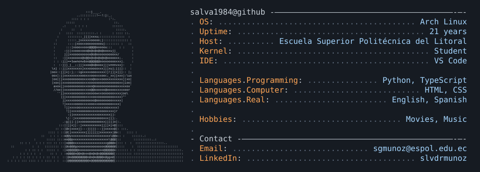

<picture>
  <source media="(prefers-color-scheme: dark)" srcset="dark_mode.svg">
  <source media="(prefers-color-scheme: light)" srcset="light_mode.svg">
  
</picture>

## Mis proyectos

A veces hago cosas:

### [Capítulos](https://github.com/salva1984/pdf-extract-chapters)

- Extrae capítulos y subsecciones de un PDF a partir de sus marcadores, para conservar solo las partes que necesitas.
- Permite revisar y editar los intervalos de páginas antes de descargarlos en un solo archivo, uniendo los tramos solapados para evitar páginas duplicadas.
- Desarrollado con TypeScript y PDF.js. Todo el procesamiento ocurre en el navegador, sin subir el documento a un servidor. [Probar la aplicación](https://salva1984.github.io/pdf-extract-chapters/).

### [OS Notes Modern](https://github.com/salva1984/os-notes-modern)

- Moderniza la interfaz de los apuntes de sistemas operativos de John Bell, de la Universidad de Illinois Chicago, conservando el contenido académico y su atribución original.
- Añade un mapa del curso, navegación entre capítulos, búsqueda de capítulos, índice de secciones e indicador de progreso para facilitar el estudio y la consulta.
- Implementado con CSS y JavaScript, con diseño adaptable a móviles y temas claro y oscuro. Funciona como sitio estático, sin compilación ni servidor de aplicación. [Consultar los apuntes](https://salva1984.github.io/os-notes-modern/).

### [Análisis de datos sobre salud mental](https://github.com/salva1984/kokoa-analisis-salud-mental)

- Explora datos relacionados con la salud mental mediante un proceso de preparación, limpieza e integración de distintas fuentes de datos.
- Utiliza Python, notebooks y visualizaciones para analizar variables y examinar sus relaciones antes del entrenamiento de modelos.
- Incluye modelos de clasificación con XGBoost y evaluación mediante matrices de confusión, curvas ROC y precisión-recall, con scripts para las distintas etapas del trabajo.

<!--
**salva1984/salva1984** is a ✨ _special_ ✨ repository because its `README.md` (this file) appears on your GitHub profile.

Here are some ideas to get you started:

- 🔭 I’m currently working on ...
- 🌱 I’m currently learning ...
- 👯 I’m looking to collaborate on ...
- 🤔 I’m looking for help with ...
- 💬 Ask me about ...
- 📫 How to reach me: ...
- 😄 Pronouns: ...
- ⚡ Fun fact: ...
-->
